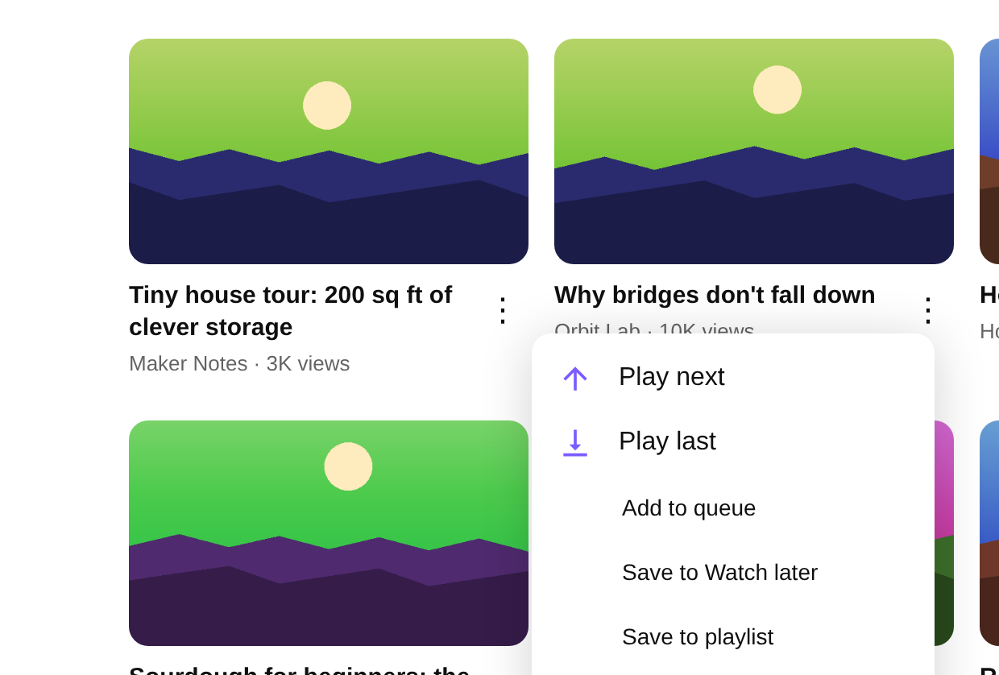
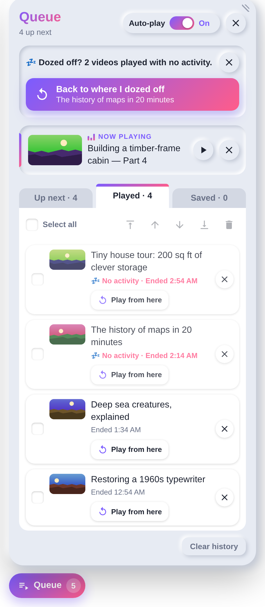
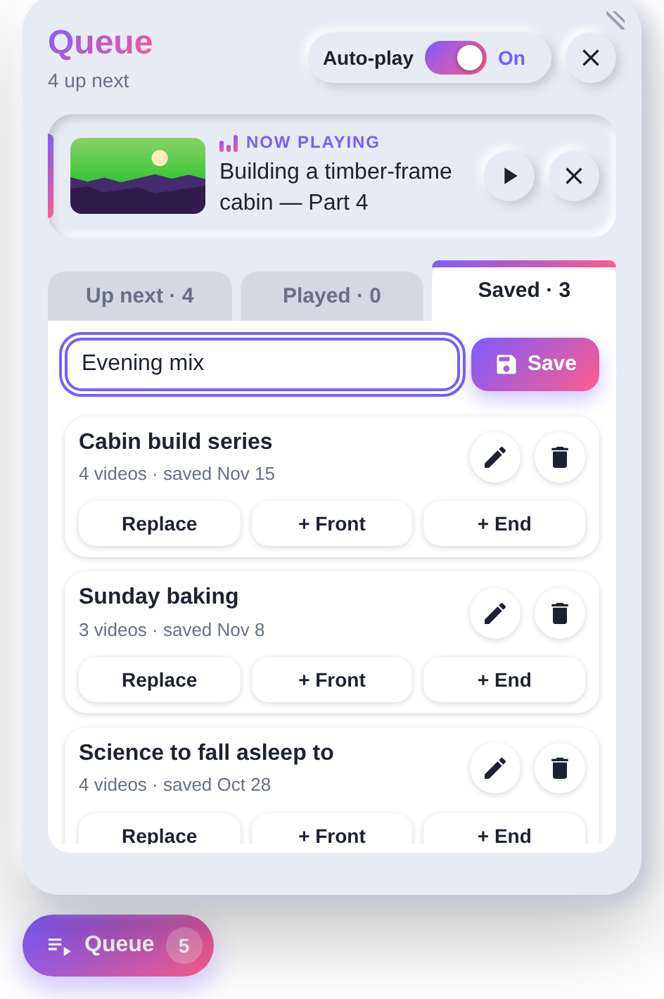
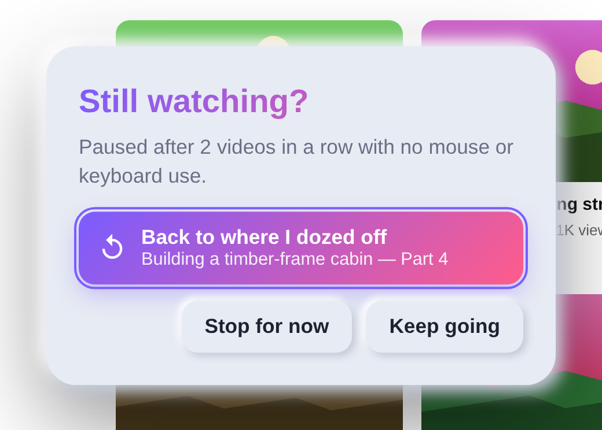
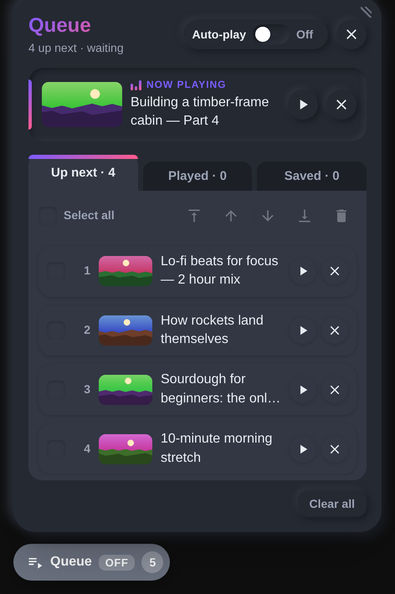

# YouTube Shadow Queue

A userscript that gives desktop YouTube the queue controls the iPhone app has:
**Play next** and **Play last**, plus a queue that remembers what you watched,
saved queues you can reload, and playback that keeps Picture-in-Picture open.


## Why

YouTube's desktop "Add to queue" always adds to the **end**. There's no "play this next".
This script adds its own queue (a "shadow" queue) that you fully control, and keeps it
safe across browser restarts.

## Features

- **Play next / Play last** in every video's ⋮ menu.
- **Keyboard:** hover a video and press **Option+N** (next) or **Option+L** (last).
- **Thumbnail "Add to queue" button** adds to the end of *this* queue
  (Option-click it to use YouTube's own queue instead).
- **No duplicates:** hovering a queued video shows **In queue · #3**.
- **Queue panel** (bottom-left): reorder with checkboxes (Shift-click for a range),
  move to top / up / down / bottom, remove, clear. Resizable; remembers its size.
- **Played tab:** finished videos with the time they ended, reorderable,
  and **Play from here** to replay a stretch you missed.
- **Fell asleep?** Videos that played with no mouse or keyboard use get a 💤.
  One click on **Back to where I dozed off** rewinds to the first one.
  After 2 untouched videos in a row it pauses and asks **Still watching?**
- **Saved tab:** save the queue under a name; load it later with
  **Replace**, **+ Front** or **+ End**. Rename and delete too.
- **Auto-play switch** (or **Option+P**): turn it off to watch anything without the
  queue jumping in; turn it back on to resume.
- **Picture-in-Picture friendly:** the next video plays in the same floating window,
  like YouTube's own queue.
- **Open tabs stay in sync.** Light and dark mode follow YouTube's theme.

## Screenshots

| Play next / Play last in the ⋮ menu | Played tab: fell asleep? |
|---|---|
|  |  |
| **Saved queues** | **Still watching?** |
|  |  |
| **Dark mode, auto-play off** | |
|  | |

<sub>Screenshots use sample videos.</sub>

## Install

1. Install a userscript manager: **[Violentmonkey](https://violentmonkey.github.io/)**
   (tested) or Tampermonkey.
2. Install the script from **Greasy Fork** *(link coming)*, or straight from GitHub:
   **[install youtube-shadow-queue.user.js](https://github.com/Claire/youtube-shadow-queue/raw/main/youtube-shadow-queue.user.js)**
   (your userscript manager opens an install page).
3. Reload any open YouTube tabs.

> After updating the script, reload open YouTube tabs. Tabs that were already open
> keep running the old version until they reload.

## Settings

Open the script in your userscript manager and edit the block at the top:

| Setting | Default | What it does |
|---|---|---|
| `MAX_ITEMS` | 500 | Most videos the queue can hold |
| `TEXT_SIZE` | 16 | Panel text size in px; everything scales with it |
| `HISTORY_SIZE` | 100 | How many finished videos the Played tab remembers |
| `STILL_WATCHING_AFTER` | 2 | Untouched videos in a row before "Still watching?" (0 = never) |
| `SMOOTH_NEXT` | true | Switch videos in place (keeps PiP). `false` = reload the page |

## Privacy

- No tracking, no analytics, no accounts, no third-party servers.
- Your queue, history and saved queues stay in your userscript manager's storage
  on your computer (Violentmonkey: the script's **Values** tab).
- The only network requests go to YouTube itself: video titles from
  `youtube.com/oembed` (sent without cookies) and thumbnails from `i.ytimg.com`.

## Limitations

- Desktop **www.youtube.com** only (not m.youtube.com or YouTube Music).
- The thumbnail **Add to queue** button is matched by its English label. With YouTube
  in another language, that one button keeps YouTube's behavior; everything else works.
- YouTube changes its page often. If the ⋮ menu items disappear, Option+N / Option+L
  still work, and the menu selectors are in one list near the top of the menu code.
- Tested with Violentmonkey in Chromium-based browsers (including Crest).

## Development

The script is one file so it can be installed directly. Tests need Node 20+.

```sh
npm install   # installs jsdom for the browser simulations
npm test      # unit tests + browser simulations
```

- `test/store.test.js`: unit tests for the queue logic (adding, moving, history,
  saved queues, limits).
- `test/sim/*.sim.js`: load the script into a fake YouTube page and check real
  behavior (menus, panel, auto-play, saved queues, in-place video switching,
  title repair, safety-net reloads).

## License

[MIT](LICENSE)
