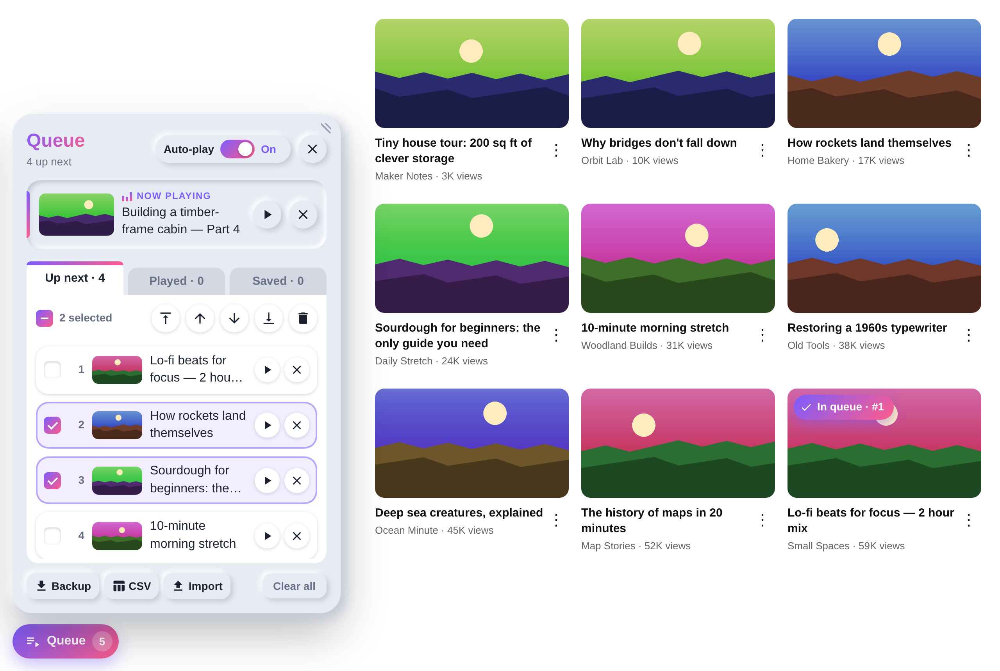
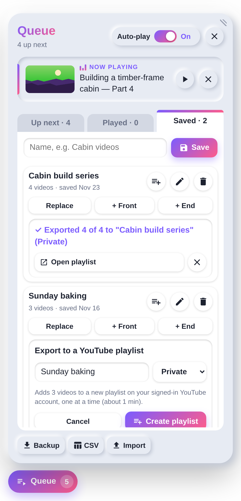
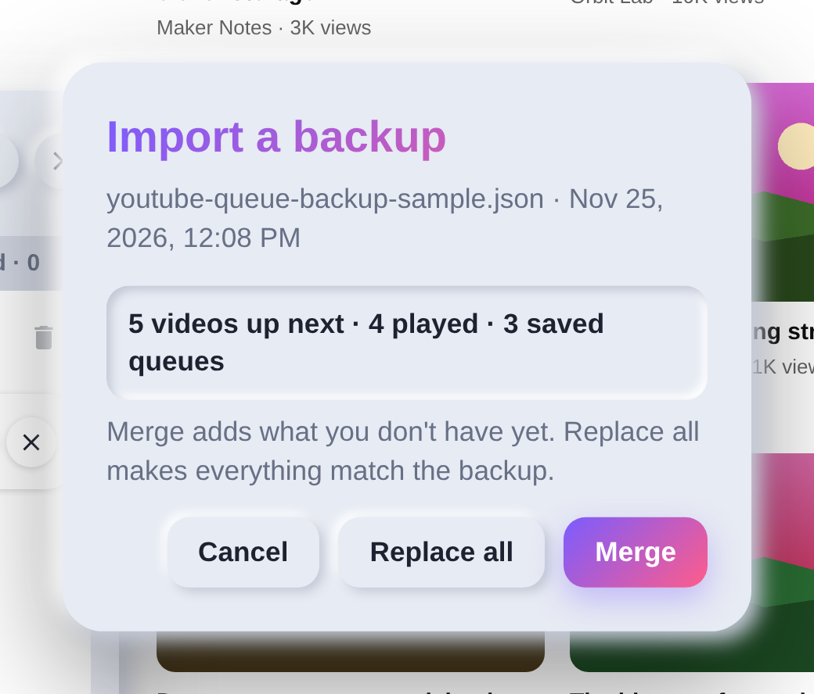

# YouTube Shadow Queue

A userscript that gives desktop YouTube the queue controls the iPhone app has:
**Play next** and **Play last**, plus a queue that remembers what you watched,
saved queues you can reload, and playback that keeps Picture-in-Picture open.



## Why

YouTube's desktop "Add to queue" always adds to the **end**. There's no "play this next".
This script adds its own queue (a "shadow" queue) that you fully control, and keeps it
safe across browser restarts.

## Features

- **Play next / Play last** in every video's ⋮ menu.
- **Keyboard:** hover a video and press **Option+N** (next) or **Option+L** (last).
- **Thumbnail "Add to queue" button** adds to the end of *this* queue
  (Option-click it to use YouTube's own queue instead).
- **No duplicates:** hovering a queued video shows **In queue · #3**.
- **Queue panel** (bottom-left): reorder with checkboxes (Shift-click for a range),
  move to top / up / down / bottom, remove, clear. Resizable; remembers its size.
- **Played tab:** finished videos with the time they ended, reorderable,
  and **Play from here** to replay a stretch you missed.
- **Fell asleep?** Videos that played with no mouse or keyboard use get a 💤.
  One click on **Back to where I dozed off** rewinds to the first one.
  After 2 untouched videos in a row it pauses and asks **Still watching?**
- **Saved tab:** save the queue under a name; load it later with
  **Replace**, **+ Front** or **+ End**. Rename and delete too.
- **Export to a YouTube playlist:** turn a saved queue into a real playlist on your
  account (Private, Unlisted or Public). Videos are added one at a time with a
  progress bar; pause and resume any time, even after a reload.
- **Backup & restore:** download everything as a `.json` file, or a `.csv` list for
  spreadsheets. **Import** a backup with **Merge** (adds only what you don't have) or
  **Replace all**. Good for moving to another browser or computer.
- **Auto-play switch** (or **Option+P**): turn it off to watch anything without the
  queue jumping in; turn it back on to resume.
- **Picture-in-Picture friendly:** the next video plays in the same floating window,
  like YouTube's own queue.
- **Open tabs stay in sync.** Light and dark mode follow YouTube's theme.

## Screenshots

| Play next / Play last in the ⋮ menu | Played tab: fell asleep? |
|---|---|
|  |  |
| **Saved queues** | **Still watching?** |
|  |  |
| **Export to a YouTube playlist** | **Dark mode, auto-play off** |
|  |  |
| **Import a backup: Merge or Replace all** | |
|  | |

<sub>Screenshots use sample videos.</sub>

## Install

1. Install a userscript manager: **[Violentmonkey](https://violentmonkey.github.io/)**
   (tested) or Tampermonkey.
2. Install the script from **Greasy Fork** *(link coming)*, or straight from GitHub:
   **[install youtube-shadow-queue.user.js](https://github.com/Claire/youtube-shadow-queue/raw/main/youtube-shadow-queue.user.js)**
   (your userscript manager opens an install page).
3. Reload any open YouTube tabs.

> After updating the script, reload open YouTube tabs. Tabs that were already open
> keep running the old version until they reload.

## Settings

Open the script in your userscript manager and edit the block at the top:

| Setting | Default | What it does |
|---|---|---|
| `MAX_ITEMS` | 500 | Most videos the queue can hold |
| `TEXT_SIZE` | 16 | Panel text size in px; everything scales with it |
| `HISTORY_SIZE` | 100 | How many finished videos the Played tab remembers |
| `STILL_WATCHING_AFTER` | 2 | Untouched videos in a row before "Still watching?" (0 = never) |
| `SMOOTH_NEXT` | true | Switch videos in place (keeps PiP). `false` = reload the page |

## Privacy

- No tracking, no analytics, no accounts, no third-party servers.
- Your queue, history and saved queues stay in your userscript manager's storage
  on your computer (Violentmonkey: the script's **Values** tab).
- **Backup** and **CSV** files are made in your browser and saved to your own
  Downloads folder; **Import** reads a file you pick. Nothing is uploaded.
- The only network requests go to YouTube itself: video titles from
  `youtube.com/oembed` (sent without cookies) and thumbnails from `i.ytimg.com`.
- **Export to a YouTube playlist** (only when you click it) uses your own signed-in
  YouTube session, sending the same requests youtube.com sends when you click
  *Save → New playlist*. To prove it's you, it sends a hash made from your YouTube login
  cookie, exactly as YouTube's own page does. The cookie itself is never sent, and
  nothing goes anywhere but youtube.com.

## Limitations

- Desktop **www.youtube.com** only (not m.youtube.com or YouTube Music).
- The thumbnail **Add to queue** button is matched by its English label. With YouTube
  in another language, that one button keeps YouTube's behavior; everything else works.
- YouTube changes its page often. If the ⋮ menu items disappear, Option+N / Option+L
  still work, and the menu selectors are in one list near the top of the menu code.
- Tested with Violentmonkey in Chromium-based browsers (including Crest).
- **Export** uses YouTube's internal web API, which isn't officially documented and can
  change without notice. If it stops working you'll see a clear message; nothing else
  in the script is affected. YouTube also seems to limit how many videos an account can
  add per day: if an export stops with a "limiting requests" message, press **Resume**
  later.

## Tools: sort a big queue (optional)

These run on your computer with Node 20+, not in the browser. They need your own
YouTube Data API key, which stays in a `.env` file that git ignores.

### 1. Get a YouTube Data API key (once)

1. Go to [Google Cloud Console](https://console.cloud.google.com/), create a project.
2. **APIs & Services → Library**, find **YouTube Data API v3**, click **Enable**.
3. **APIs & Services → Credentials → Create credentials → API key**. Under
   restrictions, limit it to **YouTube Data API v3**.
4. In this repo folder, create a file named `.env` with one line:
   `YT_API_KEY=your-key`. Never paste the key anywhere else.

### 2. Add details to a backup

In the Queue panel click **Backup**, then in this repo folder run:

```sh
node tools/enrich.mjs ~/Downloads/youtube-queue-backup-2026-11-25.json
```

It looks up every video's channel, category, tags, topics and length, prints the top
categories and channels, and saves `data/enriched.json`. It costs 1 quota unit per
50 videos (the free allowance is 10,000 units a day). Running it again only looks up
videos it hasn't seen; add `--refresh` to look everything up again. Videos that are
private or deleted are marked unavailable. If the daily allowance runs out, progress
is kept; run it again the next day.

The key is sent only to `www.googleapis.com`, in a request header, and is never printed
or saved anywhere else. `data/` holds your viewing list, so it's git-ignored too.

### 3. Sort it into smaller queues

Open `tools/organizer.html` in your browser (double-click it) and click
**Open enriched.json…** (it's in the `data` folder). No key needed.

- **Filter** on the left: search, plus where the video is now, category, channel, topic,
  tag, length, upload date (past week … over 3 years ago) and status. Ticks inside one
  filter mean "any of these"; different filters combine.
- Each video shows when it was uploaded ("2 years ago"; hover for the exact date).
  **Sort** by newest or oldest upload.
- **Tick videos** (Shift-click for a range, or **Select all shown**), type a name, and
  click **New queue from selected**. Tick **Not in a new queue yet** to see what's left.
- Click **Download for the Queue panel**, then in YouTube: Queue panel → **Import** →
  **Add saved queues**. They appear in the Saved tab; your queue isn't changed.

Your new queues are remembered in that browser while you work. The page loads nothing
but video pictures from YouTube (turn off **Pictures** to load none).

### 4. Let Claude suggest groups (optional)

YouTube's categories are rough ("People & Blogs" is often just the default). Claude can
read your titles, channels and descriptions and group videos by what they're about.
You need a Claude API key from [platform.claude.com](https://platform.claude.com/);
add a second line to `.env`: `ANTHROPIC_API_KEY=your-key`.

```sh
node tools/tag.mjs propose     # Claude suggests groups → data/groups.txt
# open data/groups.txt: rename, delete, merge or add lines ("Name: what belongs in it")
node tools/tag.mjs sort        # Claude puts each video in one of your groups
```

`sort` prints how many videos went into each group and saves `data/ai-queues.json`.
In YouTube: Queue panel → **Import** → that file → **Add saved queues**. The organizer
also gets a **Claude's groups** filter.

- `--pictures` (on either step): Claude also looks at the thumbnails, to spot styles
  like "animated", "AI cartoon" or "talking head". Thumbnails go straight from YouTube
  to Claude.
- `--only "People & Blogs"`: just one YouTube category.
- **Cost** with Claude Haiku 5.5 (the default): about 2 US cents for 500 videos, about 2.5
  with `--pictures`. It estimates first and stops above `--max-cost` (default $1).
- Answers are cached, so running `sort` again only asks about new videos. Editing
  `groups.txt` sorts everything again.
- Claude can only choose from your groups. An answer that doesn't match is ignored and
  asked again next run.
- The key is sent only to `api.anthropic.com`, in a request header, and is never printed
  or saved anywhere else. To use another model, add `CLAUDE_MODEL=...` to `.env`.

## Development

The script is one file so it can be installed directly. Tests need Node 20+.

```sh
npm install   # installs jsdom for the browser simulations
npm test      # unit tests + browser simulations
```

- `test/enrich.test.mjs`: tests for `tools/enrich.mjs` against a fake YouTube
  (batching, cache, quota stop, error advice, and that the key never leaks).
- `test/tag.test.mjs`: tests for `tools/tag.mjs` against a fake Claude (groups file,
  batching, pictures, cache, cost limit, error advice, and that the key never leaks).
- `test/store.test.js`: unit tests for the queue logic (adding, moving, history,
  saved queues, limits, backup merge/replace, CSV).
- `test/sim/organizer.sim.js`: drives `tools/organizer.html` and checks the userscript
  accepts what it downloads.
- `test/sim/*.sim.js`: load the script into a fake YouTube page and check real
  behavior (menus, panel, auto-play, saved queues, in-place video switching,
  title repair, safety-net reloads, exporting to a playlist against a fake YouTube API,
  backup download and import).

## Credits

The playlist export follows the approach of
[channel-to-playlist](https://github.com/hubert2gavin/channel-to-playlist) by Hubert Gavin
(MIT License): create the playlist once, add videos one at a time, back off when YouTube
is busy, and skip unavailable videos.

## License

[MIT](LICENSE)
