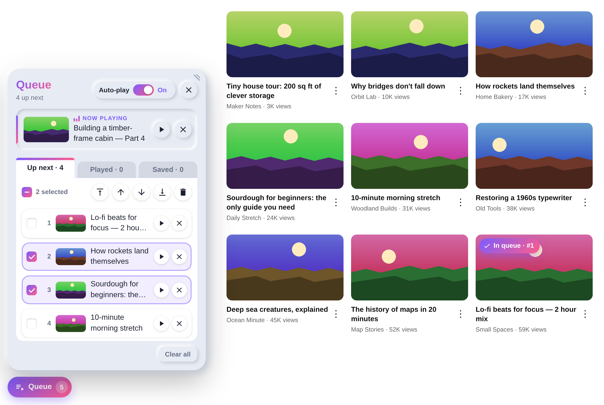
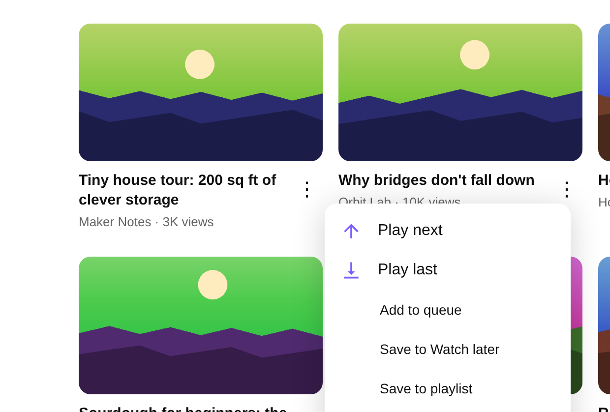
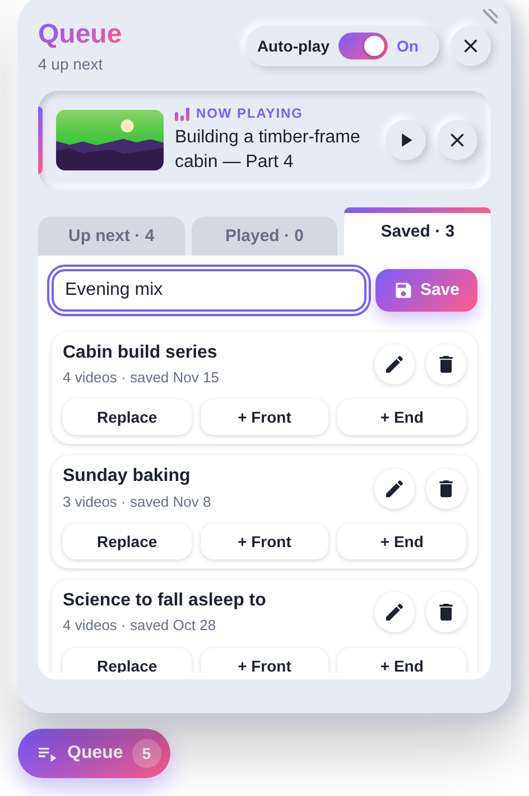
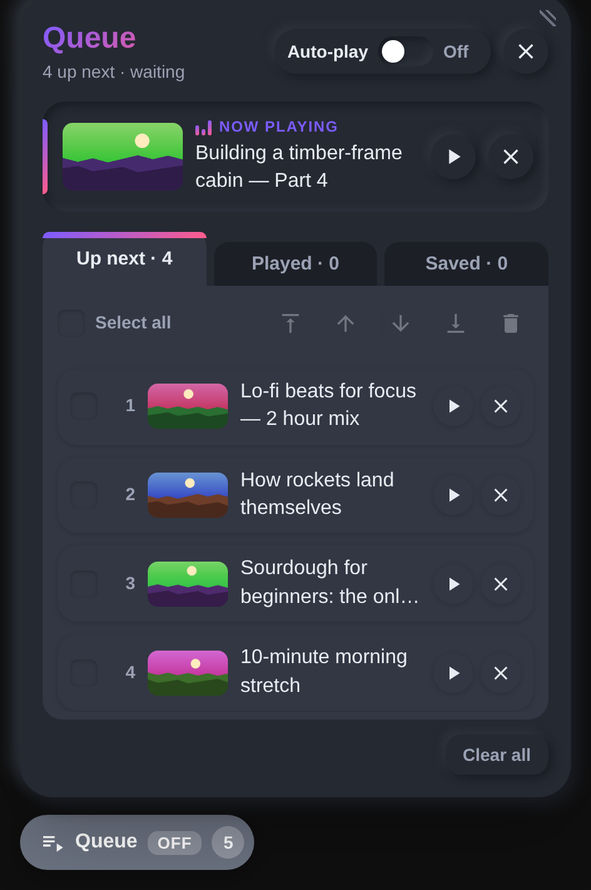
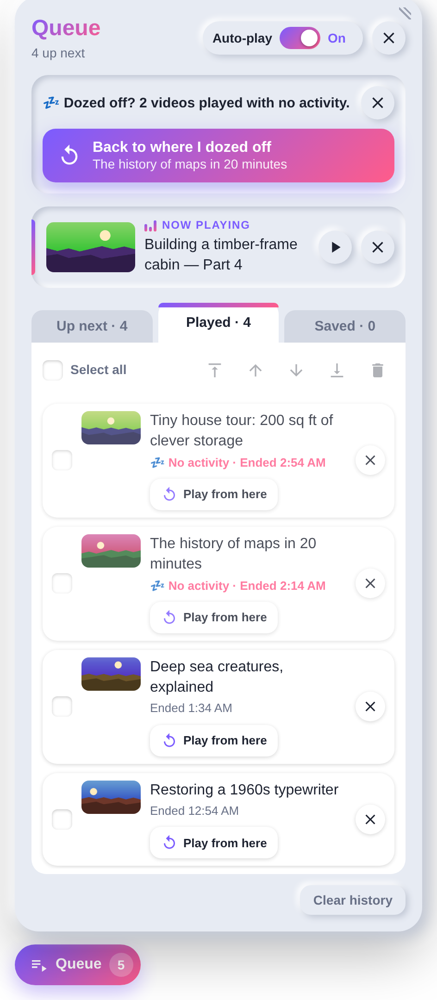
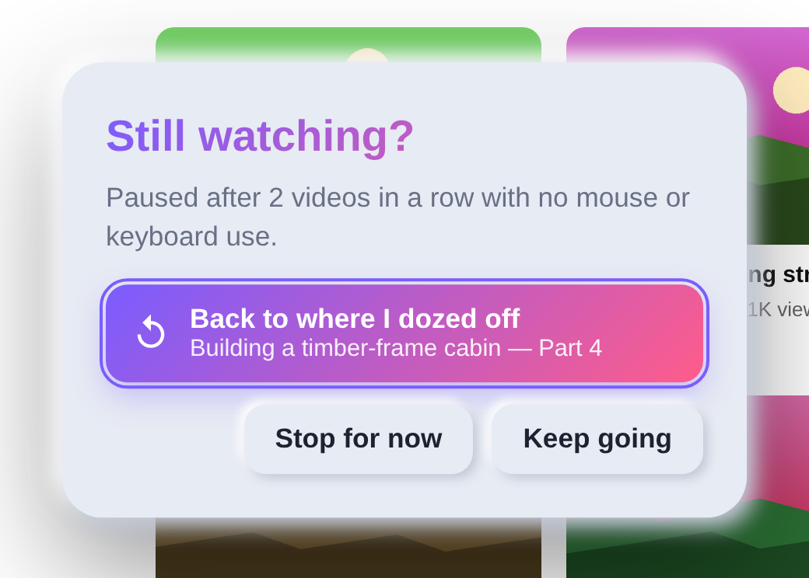

**Play next** and **Play last** for desktop YouTube, like the iPhone app, with a queue that remembers what you watched, saved queues, and Picture-in-Picture-friendly playback.

YouTube's desktop "Add to queue" always adds to the end. This script adds its own queue that you fully control. It survives browser restarts, and the next video keeps playing in the same Picture-in-Picture window.

### Adding videos
- **⋮ menu** on any video → **Play next** or **Play last**
- **Hover + Option+N** (next) or **Option+L** (last)
- The thumbnail's **Add to queue** button adds to the end of this queue (Option-click it to use YouTube's own queue)
- Already queued? Hovering shows **In queue · #3**, and it's never added twice

### The Queue panel (bottom-left)
- **Up next:** checkboxes (Shift-click for a range), move to top / up / down / bottom, remove, clear
- **Played:** finished videos with the time they ended; reorder, remove, **Play from here**
- **Saved:** save the queue under a name, then load it with **Replace**, **+ Front** or **+ End**
- **Auto-play switch** (or **Option+P**): off = watch anything, the queue waits
- Resizable, remembers its size, follows YouTube's light/dark theme, large readable text

### Fell asleep?
Videos that played with no mouse or keyboard use get a 💤. **Back to where I dozed off** rewinds to the first one in one click. After 2 untouched videos in a row, the queue pauses and asks **Still watching?** (adjustable).

### Settings
Edit the block at the top of the script: queue size, text size, history length, the "Still watching?" count, and in-place switching.

### Privacy
No tracking, analytics or third-party servers. Your data stays in your userscript manager's storage. The only requests go to YouTube itself: titles from youtube.com/oembed (no cookies sent) and thumbnails from i.ytimg.com.

### Notes
- Desktop www.youtube.com only.
- The thumbnail "Add to queue" button is matched by its English label; everything else works in any language.
- After updating the script, reload open YouTube tabs.
- Tested with Violentmonkey in Chromium-based browsers.

Source, tests and issues: [github.com/Claire/youtube-shadow-queue](https://github.com/Claire/youtube-shadow-queue)
